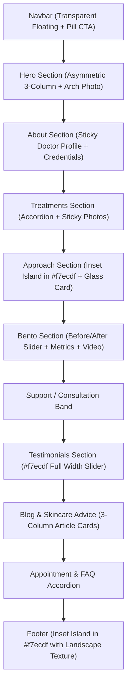

# Design System & Technical Analysis: Dermato Webflow Template

> **Reference URL:** [https://dermato-wbs.webflow.io/](https://dermato-wbs.webflow.io/)  
> **Target Industry:** Dermatology, Aesthetic Medicine, Luxury Medical Clinics  
> **Design Philosophy:** Organic Warmth, Editorial Editorial Serifs, Bento Grid Storytelling, and Subtle High-Trust Accents.

---

## 1. Executive Summary & Aesthetic Identity

The **Dermato** website template represents a sophisticated evolution of modern medical and aesthetic clinic web design:
1. **Abandoning Clinical Coldness:** Instead of stark whites, cold hospital blues, or generic teal, the site uses an ultra-warm palette rooted in **Chestnut Cocoa (`#633b2c`)**, **Bronze Ochre (`#986a3e`)**, and an organic foundation of **Warm Ivory/Porcelain (`#fdf7ef`)** and **Alabaster Beige (`#f7ecdf`)**.
2. **Typography Duet:** It pairs an elegant, high-personality display serif (**Hedvig Letters Serif**) for headlines with a clean, geometric sans-serif (**General Sans**) for crisp body copy and operational UI.
3. **Pill & Arch Geometry:** Every interactive element uses gentle, organic geometry: full-pill buttons (`30px` radius), arched photo masks (`12.5rem` / `200px`), and soft container cards (`20px` to `30px` radius).
4. **Bento Grid Presentation:** Clinical results, before/after comparisons, statistics, and video testimonials are composed inside a cohesive **Bento Grid** layout rather than isolated standalone carousels.

---

## 2. Color Palette & Systematic Roles

```
┌────────────────────────────────────────────────────────────────────────┐
│ PRIMARY BACKGROUND: #fdf7ef (Gray-2: Warm Cream Ivory)                 │
│                                                                        │
│   ┌──────────────────────────────────────────────────────────────────┐ │
│   │ SECONDARY SECTION / CARD SURFACE: #f7ecdf (Gray-3: Soft Alabaster) │ │
│   │                                                                  │ │
│   │   ┌────────────────────────────────────────────────────────────┐ │ │
│   │   │ HIGH CONTRAST / POP SURFACE: #ffffff (Pure White)          │ │ │
│   │   └────────────────────────────────────────────────────────────┘ │ │
│   └──────────────────────────────────────────────────────────────────┘ │
└────────────────────────────────────────────────────────────────────────┘

HEADINGS / PRIMARY BRAND: #633b2c (Chestnut Cocoa)
BUTTONS / CTAs / ACCENTS: #986a3e (Warm Bronze Gold)
BODY TEXT:                #7a685d (Warm Muted Umber)
```

| Token Variable | Hex Code | Visual Role & Usage in Template |
|---|---|---|
| `--color--gray-2` | `#fdf7ef` | **Global Canvas Background**: Applied to `body`, creates the signature warm, soothing ivory base of the clinic. |
| `--color--gray-3` | `#f7ecdf` | **Section Contrast & Inset Panels**: Used as background for the Testimonial section, the Approach section banner, the Footer background, and secondary bento cards. |
| `--color--white` | `#ffffff` | **Card Highlights & Micro-Containers**: Used for icon badge circles, select bento tiles, and interactive inputs. |
| `--color--chestnut` | `#633b2c` | **Primary Brand / Headings**: All `h1` through `h6`, primary titles, mobile hamburger button, and footer links. |
| `--color--bronze` | `#986a3e` | **Active CTAs & Highlights**: Primary buttons (`.button-primary`), active states, tag pills, and accent icons. |
| `--color--body` | `#7a685d` | **Body Typography**: Soft dark warm gray for high legibility without the harshness of pure black `#000`. |
| `--color--chestnut-10`| `#633b2c1a` | **Hairline Borders**: `1px solid` borders around accordion items and card dividers. |
| `--color--bronze-50` | `#986a3e80` | **Glassmorphism Gradients**: Background for frosted glass info cards and blurred backdrop effects. |

---

## 3. Typography Hierarchy & Rules

### Font Families
- **Display / Heading Family:** `"Hedvig Letters Serif", Georgia, serif`
  - Unhurried, editorial serif with delicate character. Used with `font-weight: 400` across all major headings.
- **Body / Interface Family:** `Generalsans, Arial, sans-serif`
  - Clean geometric humanist sans-serif. Used with `font-weight: 500` for body copy and `600` for labels/buttons.

### Scale Specifications
- **Display Big:** `12.5rem` (`200px`), `line-height: 1em`, `font-weight: 400`.
- **H1 (Hero Headline):** `5.625rem` (`90px`), `line-height: 1.1em`, `font-weight: 400` *(Responsive: `3.75rem` at tablet, `3.25rem` at mobile)*.
- **H2 (Section Titles):** `4.375rem` (`70px`), `line-height: 1.2em`, `font-weight: 400` *(Responsive: `2.875rem` at tablet, `2.25rem` at mobile)*.
- **H3 (Card & Sub-features):** `3.75rem` (`60px`), `line-height: 1.2em`, `font-weight: 400`.
- **H4 (Accordion & Bento Titles):** `2.875rem` (`46px`), `line-height: 1.2em`.
- **H5 (Small Card Headers):** `1.875rem` (`30px`), `line-height: 1.2em`.
- **H6 / Eyebrows:** `1.375rem` (`22px`), `line-height: 1.2em`.
- **Body Large:** `1.125rem` (`18px`), `line-height: 1.4em`.
- **Body Medium (Default):** `1rem` (`16px`), `line-height: 1.3em`, `font-weight: 500`.
- **Body Small (Labels/Meta):** `0.875rem` (`14px`), `line-height: 1.3em`.
- **Body XS (Pills/Badges):** `0.75rem` (`12px`), `line-height: 1.3em`.

---

## 4. Layout Architecture & Section Breakdown

The page follows a deliberate sequence of full-width canvas spaces alternating with inset rounded island blocks:



### 1. Header & Navigation (`.navbar`)
- **Background:** `transparent` (floats above page canvas).
- **Navigation Items:** Clean sans-serif links in `--color--chestnut`.
- **Right CTA:** `.button-icon-primary` with pill shape (`border-radius: 1.875rem`), background `--color--gray-3` (`#f7ecdf`), featuring an icon circle (`24px × 24px` white circle with 12px arrow icon) beside text "Book Appointment".

### 2. Hero Section (`.hero-section`)
- **Structure:**
  - **Top Row (3 Columns):**
    - Left: "Board Certified" credential box with micro icon and certification description.
    - Center: Prominent H1 *"Healthy, confident skin starts here"* with concise 2-line intro.
    - Right: Trust badge with star rating (`5.0` stars) and patient review counter.
  - **Bottom Center Piece:**
    - Large arched visual mask (`border-radius: 12.5rem 12.5rem 0 0` or rounded container).
    - Centered circular badge (`hero-button-info`) floating at the apex with circular text or rotation.
    - Patient avatar stack overlapping the bottom left.

### 3. Treatments & Services (`.service-section`)
- **Layout:** Vertical accordion items (`.service-accordion-item`).
- **Styling:**
  - Background: `--color--gray-2` (`#fdf7ef`).
  - Border: `1px solid var(--color--chestnut-10)`.
  - Border radius: `var(--border-radius--md)` (`30px`).
  - Expanding content reveals 3-column image gallery (`.service-image-item`) with rounded corners (`20px`).
  - Active state expands smoothly with toggle button (`30px × 30px` circular white toggle at top right).

### 4. Our Approach Section (`.approach-section`)
- **Visual Pattern:** **Inset Island Container** (`.approach-bg`).
  - Unlike standard full-width bleed sections, the entire section sits inside a rounded container with `3.125rem` margin gutters.
  - Background: **`--color--gray-3` (`#f7ecdf`)**.
  - Border radius: `var(--border-radius--md)` (`30px`).
  - Padding: `10rem` top and bottom.
- **Content:**
  - Left: Doctor photo (`Dr. Sarah Mitchell`) with a frosted glass client card at the bottom (`backdrop-filter: blur(16px)`, `border: 1px solid rgba(255,255,255,0.1)`).
  - Right: Editorial philosophy, headline *"A clinic committed"*, and a feature list with white rounded icon boxes (`40px × 40px`, `border-radius: 30px`).

### 5. Bento Section & Before-After Slider (`.bento-section`)
This is the core inspiration area for clinical results:
- **Section Heading:** *"Care that puts your child first"* / *"Why patients choose us"*.
- **The Before-After Card (`.before-after-wrapper`):**
  - Dimensions: Width `100%`, Height `560px` (desktop), `487px` (tablet), `400px` (mobile).
  - Border radius: `var(--border-radius--md)` (`30px`), `overflow: hidden`.
  - Structure: Dual layered images (`.before-wrapper` and `.after-wrapper`) with interactive reveal.
- **Accompanying Bento Tiles:**
  - **Tile 1 (Results Overview):** *"Real results, real patients"* badge with treatment tag.
  - **Tile 2 (Stats / Counter):** Large metric display (`10+` years of experience, `98%` satisfaction).
  - **Tile 3 (Video Feature):** Background video card (`.bento-bg-video`) with ambient motion and overlay text.
  - **Tile 4 (Live Ticker Review):** Compact patient quote with star icon and sliding review ticker.

### 6. Testimonials Section (`.testimonial-section`)
- **Background:** **`--color--gray-3` (`#f7ecdf`)** full width.
- **Padding:** `12.5rem` top and bottom (`var(--_layout---spacing--section-spacing)`).
- **Layout:** Grid with left-aligned headline & narrative, and right-aligned interactive slider mask with patient cards and circular navigation arrows.

### 7. Footer (`.footer`)
- **Structure:** Inset rounded island (`.footer-bg`) sitting inside the outer container with `border-top-left-radius: 30px` and `border-top-right-radius: 30px`.
- **Background:** `--color--gray-3` (`#f7ecdf`) combined with a soft landscape texture (`footer.jpg`) and a gradient fade overlay (`linear-gradient(180deg, transparent, #fdf7ef 52%)`).
- **Navigation:** Multi-column layout with chestnut links, appointment button, social badges (`36px × 36px` rounded squares), and copyright notice.

---

## 5. UI Components & Micro-Interactions

### A. Buttons & CTAs
1. **Primary Button (`.button-primary`):**
   - Background: `--color--bronze` (`#986a3e`).
   - Color: `--color--white` (`#ffffff`).
   - Border: `1px solid var(--color--bronze)`.
   - Radius: `1.875rem` (`30px` pill).
   - Padding: `0.625rem 1.25rem` (`10px 20px`).
   - Font: `0.875rem` (`14px`), `font-weight: 500`.
   - Hover state: Background switches to `--color--gray-2` (`#fdf7ef`), border switches to `--color--chestnut` (`#633b2c`), text color switches to `--color--body` (`#7a685d`).
2. **Icon Button (`.button-icon-primary`):**
   - Pill container in `--color--gray-3` (`#f7ecdf`).
   - Inner white circle (`24px × 24px`) housing a crisp 12px arrow icon.
   - Smooth transform on hover.

### B. Cards & Containers
- **Standard Card:** `border-radius: 1.875rem` (`30px`), `background-color: var(--color--gray-3)` or `#ffffff`.
- **Glassmorphism Overlay Card:** `backdrop-filter: blur(16px)`, `background: linear-gradient(180deg, transparent, rgba(152, 106, 62, 0.5))`, `border: 1px solid rgba(255, 255, 255, 0.1)`.
- **Badge Pills (`.bento-card-badge`):** `padding: 0.313rem 0.625rem`, `border-radius: 20px`, `background: #ffffff`, text in chestnut.

---

## 6. Key Takeaways & Recommendations for Lúmina Clinic

Analyzing the Dermato template provides high-impact solutions for Lúmina's pending sections (**Before-After** and **Process**):

1. **Section Background Strategy:**
   - Notice how Dermato alternates between **Canvas Ivory (`#fdf7ef`)** and **Warm Alabaster Beige (`#f7ecdf`)**.
   - For Lúmina, placing the **Before-After results** or **Process** on an inset container of soft warm beige/alabaster (`#f7ecdf` or `#faf8f2`) with rounded corners (`20px - 30px`) creates instant editorial prestige.
2. **Before-After Presentation:**
   - Rather than an isolated carousel, Dermato packages the before-after image inside a **Bento layout** alongside a key stat (e.g. *"98% satisfacción"*) and patient testimonial badge. This significantly increases patient trust and conversion.
3. **The Process Section ("Our Approach"):**
   - Dermato's "Approach" section uses an **Inset Island Block (`.approach-bg`)** with the doctor's portrait on the left and a structured step list on the right with white circular icon boxes (`40px`). This matches Lúmina's goal of making the consultation process feel deeply personal, calm, and scientific.
4. **Pill Buttons:**
   - The pill CTA with an embedded white icon circle (`.button-icon-primary`) is one of the most distinguished elements of this aesthetic.
